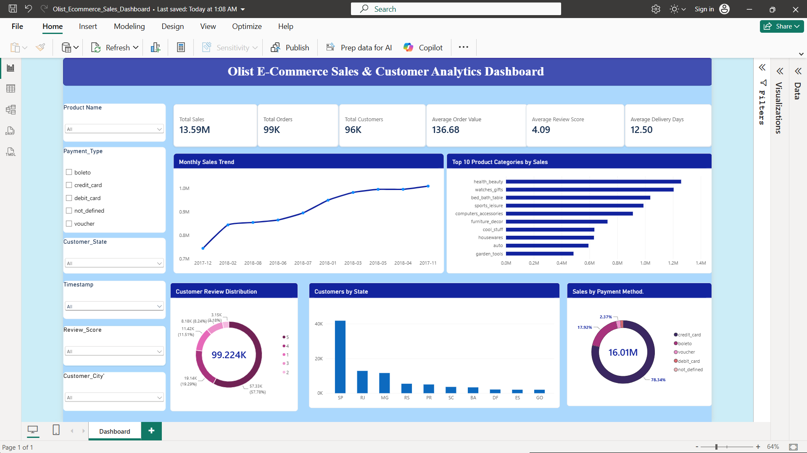

# 📊 Olist E-Commerce Sales & Customer Analytics Dashboard

## 🖥️ Dashboard Preview

---

## 📌 Project Overview

This project focuses on analyzing the Brazilian Olist E-Commerce Public Dataset using Microsoft Power BI.

The main objective is to transform raw e-commerce data into meaningful business insights through data cleaning, data transformation, data modeling, DAX calculations, and interactive visualizations.

The dashboard provides an overview of sales performance, customer distribution, product category performance, payment preferences, customer satisfaction, and delivery operations.

## 🎯 Business Problem

E-commerce businesses generate large amounts of data related to orders, customers, products, payments, and deliveries. Without proper analysis, it becomes difficult to identify business performance trends and improvement opportunities.

This project addresses three main business problems:

1. **Sales Performance Analysis:** Identify monthly sales trends, revenue performance, and top-performing product categories.
2. **Customer Behavior Analysis:** Understand customer distribution across states, payment preferences, and customer satisfaction.
3. **Delivery Performance Analysis:** Evaluate average delivery time and identify opportunities to improve delivery efficiency.

## 🎯 Project Objectives

- Analyze overall sales and revenue performance.
- Identify the highest revenue-generating product categories.
- Understand monthly sales trends.
- Analyze customer distribution across Brazilian states.
- Evaluate payment method preferences.
- Measure customer satisfaction through review scores.
- Analyze average order delivery time.

## 🛠️ Tools & Technologies

| Tool | Purpose |
|---|---|
| Microsoft Power BI | Dashboard development |
| Power Query | Data cleaning and transformation |
| DAX | Measures and calculations |
| Data Modeling | Relationships between tables |
| CSV / Excel | Data source and handling |
| GitHub | Project documentation and version control |

## 📈 Key Performance Indicators (KPIs)

| KPI | Description |
|---|---|
| Total Sales | Total revenue from order items |
| Total Orders | Unique number of orders |
| Total Customers | Unique number of customers |
| Average Order Value | Average sales value per order |
| Total Items Sold | Total number of order items |
| Total Freight | Total freight charges |
| Average Delivery Days | Average time taken to deliver orders |
| Average Review Score | Average customer review rating |

### Dashboard KPI Highlights

| Metric | Result |
|---|---:|
| Total Sales | 13.59M |
| Total Orders | 99K |
| Total Customers | 96K |
| Average Order Value | 136.68 |
| Average Delivery Days | 12.50 Days |
| Average Review Score | 4.09 / 5 |

*Values are based on the current dashboard view.*

## 📊 Dashboard Features & Analysis

### 1. Sales Performance Analysis
- Monthly sales trend analysis.
- Overall sales revenue tracking.
- Identification of sales patterns over time.

### 2. Product Category Analysis
- Top 10 product categories by sales.
- Comparison of category-wise revenue.
- Identification of high-performing categories.

### 3. Customer Analysis
- Customer distribution by Brazilian state.
- Analysis of customer locations.
- Understanding customer reach.

### 4. Payment Method Analysis
- Payment distribution by payment type.
- Analysis of customer payment preferences.
- Comparison of payment methods.

### 5. Customer Review Analysis
- Distribution of customer review scores.
- Average customer review score.
- Customer satisfaction overview.

### 6. Delivery Performance Analysis
- Average delivery days.
- Evaluation of order delivery performance.

## 🔍 Key Business Questions

1. Which product categories generate the highest sales, and how do sales trends change over time?
2. Which states have the highest number of customers, and what are their preferred payment methods?
3. What is the average delivery time, and how satisfied are customers with their shopping experience?

